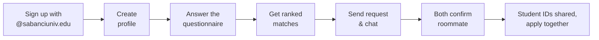
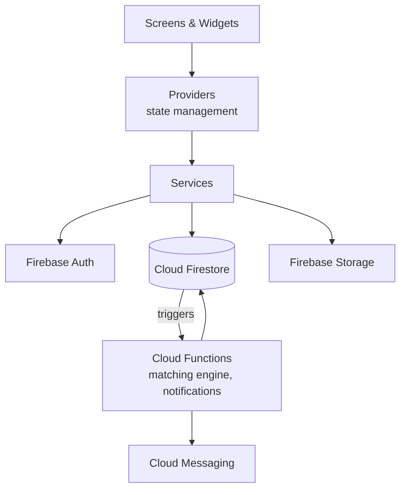

<div align="center">

# 🏠 Roommate Finder

**Find a roommate you'll actually get along with, before dorm applications open.**


CS 310 Mobile Application Development · Sabancı University · **Group 42**

</div>

---

## 📖 About the project

At Sabancı University, as at many universities in Turkey and Europe, students who apply for the dorms without a roommate are paired **at random**. New students usually don't know anyone on campus yet, so they end up living with a stranger. Differences in sleep schedule, cleanliness, noise, guests and personal boundaries are one of the most common sources of stress in the first year.

The dorm application already lets two students request each other as roommates using their **student IDs**. **Roommate Finder** helps students make good use of that option: it matches them by compatibility, gives them time to get to know each other, and lets them apply for the dorm together.

**Intended users:** Sabancı students planning to live in the dorms, especially first-year and exchange students who don't yet know anyone on campus.

## ⚙️ How it works



1. **Sign up** with a verified university email.
2. **Answer a questionnaire** about sleep, cleanliness, noise, guests, studying and lifestyle, plus dealbreakers like smoking.
3. **Get matches**, each with a compatibility score and the reasons behind it, e.g. *"You both sleep before midnight and prefer a quiet room."*
4. **Send a request.** If the other student accepts, a chat opens so you can get to know each other.
5. **Confirm.** When both students confirm, each sees the other's student ID for the dorm application.

> 💡 **Honest answers by design.** The questionnaire asks about concrete behavior (*"How long do dishes usually sit before you wash them?"*) instead of self-ratings. The app matches similar people rather than judging them, so an untrue answer only leads to a worse match for the user.

## ✨ Features

### Core features

- [ ] 🔐 **Verified sign-up:** only `@sabanciuniv.edu` emails, with email verification
- [ ] 👤 **Student profile:** name, photo, program, year, gender and a short bio
- [ ] 📝 **Compatibility questionnaire:** grouped sections plus dealbreakers
- [ ] 🎯 **Matching:** ranked list with a % score and the main reasons for each match
- [ ] 🤝 **Roommate requests:** send, accept or decline; contact details stay hidden until both accept
- [ ] 💬 **In-app chat:** real-time messaging between matched students
- [ ] ✅ **Roommate confirmation:** student IDs revealed only after both confirm

### Optional features (if time allows)

- [ ] 🔔 Push notifications for new requests and messages
- [ ] 🚫 Block and report users
- [ ] 🙈 Hide profile once a roommate is found
- [ ] ✏️ Edit questionnaire answers later
- [ ] 🧩 Detect contradictory answers
- [ ] 🔍 Filters on the match list
- [ ] ⏰ Reminder before the dorm application deadline
- [ ] 🌙 Dark mode

## 🛠️ Tech stack

| Layer | Technology |
|---|---|
| Mobile app | Flutter (Dart), Android |
| State management | Provider |
| Authentication | Firebase Authentication |
| Database | Cloud Firestore |
| File storage | Firebase Storage (profile photos) |
| Server logic | Cloud Functions (matching, notifications) |
| Notifications | Firebase Cloud Messaging |

No external API is needed: the matching algorithm is our own code.

## 🏗️ Architecture



Screens never talk to Firebase directly. They read state from **providers**, providers call **services**, and only services touch Firebase. Matching and other sensitive logic runs in **Cloud Functions** on the server.

### Planned project structure

```
lib/
├── models/      # User, Question, Answer, Match, Connection, Message
├── services/    # All Firebase access (auth, users, questionnaire, matching, chat)
├── providers/   # App state for each feature
├── screens/     # auth, onboarding, matches, requests, chat, profile, settings
├── widgets/     # Reusable UI components
└── utils/       # Theme, constants, validators
```

## 🔒 Privacy

- Only verified university students can use the app.
- Student IDs and contact details are shown **only** after both students confirm each other.
- No questions about sensitive topics such as religion or health (in line with KVKK).
- Users can edit their answers, hide their profile, or delete their account at any time.

## 🚀 Getting started

**Requirements:** Flutter SDK, Android Studio with an Android emulator (or an Android phone with USB debugging), and access to the team's Firebase project.

```bash
# Clone the repository
git clone https://github.com/turanaskerli/cs-310-project.git
cd cs-310-project

# Install dependencies
flutter pub get

# Run on a connected device or emulator
flutter run
```

## 👥 Team

| Member | Student ID | Responsibility |
|---|---|---|
| **Turan Asgarli** *(Step 1 coordinator)* | 36689 | Backend: questionnaire and matching algorithm |
| **Murad Mammadov** | 36688 | Frontend: screens, navigation and UI |
| **Bassam Khoja** | 36035 | Backend: sign-up, profiles and security |
| **Mustafa Arda Terzi** | 35266 | Backend: roommate requests, chat and notifications |

## 📌 Project status

🚧 **Step 1: Proposal and repository setup.** Development starts in the next project step.

---

<div align="center">
Made by Group 42 for CS 310 at Sabancı University
</div>
